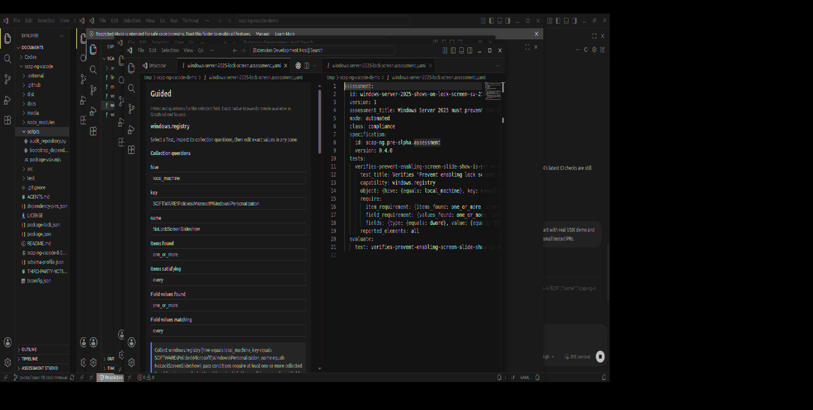

# Issue #30 — real VSIX baseline receipt

Captured 2026-11-03 on VS Code 1.128.0/Linux at 1920×968 using the locally built VSIX. The screenshot is a real host capture, not a mockup:



## Exact inputs

- Canonical `scap-ng`: `463675f3b931e596c922352a131cb3c515ab2265`
- `scap-ng-tools`: `1f4f74d215ecb6ac16ded2da9bfe447a9dc45a42`
- Current sample data: `950b9f6ac75e51fbe0bf20a1a8713ca2f1d27136`
- Metadata profile: `schema-profile.json`, 235-resource offline pack

## Reproduction

```sh
npm ci
npm run bootstrap:pack
npm run verify:offline
npm test
npm run lint
npm run package:vsix
unzip -t scap-ng-vscode-0.0.1.vsix
code --install-extension scap-ng-vscode-0.0.1.vsix --force
```

The host demo opened the canonical Windows Registry DWORD Assessment in the custom editor and a native YAML editor for the same file. Extension-host logs confirmed activation without runtime network or missing-package errors after the VSIX dependency fix. The native editor was opened by a temporary local demo command solely to exercise the host; that helper is not part of the extension or repository.

## Current baseline observations

- The VSIX must carry its runtime `yaml`/`ajv` dependency closure; VS Code does not run `npm install` for an installed extension.
- The custom workbench currently still contains an embedded Source textarea. The next focused PR replaces that editable textarea workflow with the native YAML editor beside the Guided/Graphical workbench while retaining one TextDocument and existing range edits.
- Canonical Windows Registry, Linux `/home` nosuid, optional Input, SYSVOL and manual fixtures are available in the local demo workspace. No scanner/evaluator was invoked and no compliance result is claimed.
